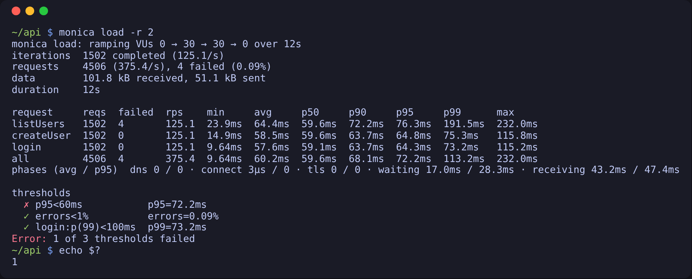
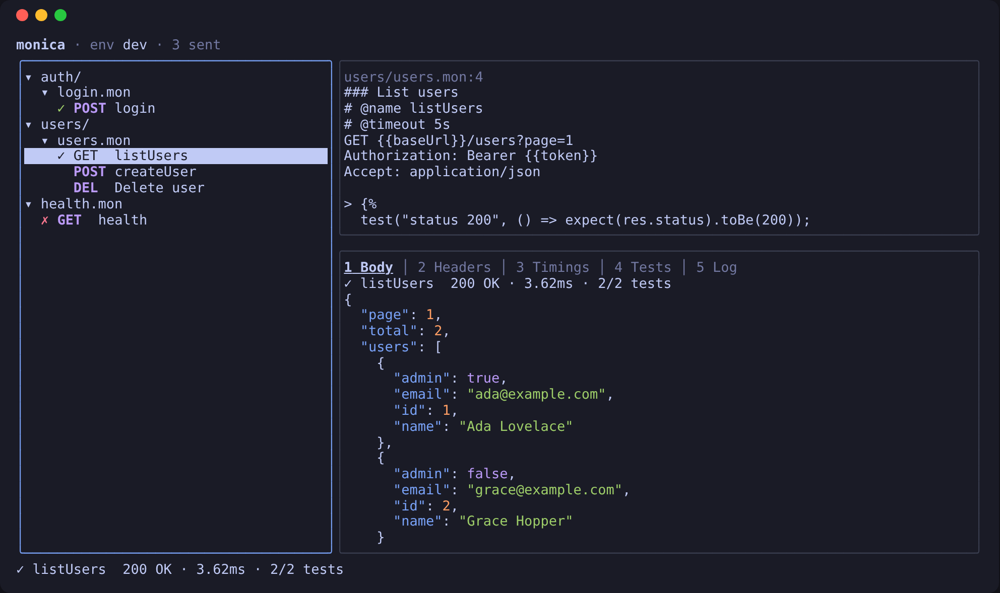
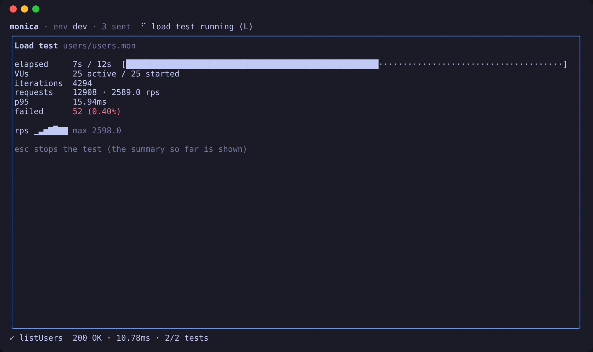

# Monica

Monica runs **HTTP requests written as plain-text `.mon` files**, checks the responses with
**JavaScript tests**, and **load-tests** the same files. It is a single binary: no Node.js,
no account, no GUI required (though there is a [terminal UI](#interactive-ui-monica-tui)).

```
### Get a user
GET https://httpbin.org/get?name=ada
Accept: application/json

> 
```

Keep `.mon` files next to your code, review them in pull requests, and run them in CI.

**Contents:** [Install](#install) · [Quick start](#quick-start) · [Usage](#usage) ·
[Validate](#validate-without-sending-monica-validate) · [Shell completion](#shell-completion) ·
[Importing](#importing-curl-postman-bruno) · [Load testing](#load-testing) ·
[TUI](#interactive-ui-monica-tui) · [Scripting](#scripting) · [Modules](#modules) ·
[Folder hooks](#folder-hooks-monicajs) · [Configuration](#configuration) ·
[Mon file format](#mon-file-format) · [Examples](examples/README.md) (runnable, one feature per folder)

## Features
* `.mon` files: raw HTTP requests with `{{variables}}`, directives (`@name`, `@timeout`,
  `@retry`, `@skip`), body files and multipart uploads.
* `monica.yml`: environments, default headers, `${SECRET}` values from the environment or
  `.env` (masked in output), run order.
* Pre-request and post-response scripts with `test()` / `expect()`, shared modules
  (CommonJS, ES modules, TypeScript), folder hooks and built-in crypto/encoding/JSONPath.
* Chaining with `vars.set()`, a cookie jar per run, data-driven runs (`--data` CSV/JSON).
* Console, JSON and JUnit reports; exit codes for CI.
* `monica validate`: check syntax, configs, scripts and variables without sending anything.
* Shell completion for bash, zsh, fish and PowerShell (`monica completion`), including
  environment names and `.mon` files.
* `monica load`: virtual users, ramping stages, arrival rates, percentiles, thresholds.
* `monica tui`: browse, send and load-test requests in an interactive terminal UI.
* `monica init` to start a project; `monica import curl|postman|bruno` to bring existing requests over.

## Install

Pick one; each gives you a `monica` command. Check it with `monica --version`.

* **Binary** (Linux, macOS, Windows, FreeBSD) — download the archive for your system from the
  [releases page](https://github.com/cortiz/monica/releases), unpack it and put `monica` on
  your `PATH`:
  ```bash
  # Linux x86_64 shown; the others are monica_<Os>_<arch>.tar.gz (Darwin, Linux, Freebsd;
  # x86_64, arm64, armv6, riscv64) and monica_Windows_<arch>.zip
  VERSION=v1.0.0-rc.2
  curl -LO https://github.com/cortiz/monica/releases/download/$VERSION/monica_Linux_x86_64.tar.gz
  tar -xzf monica_Linux_x86_64.tar.gz monica
  sudo mv monica /usr/local/bin/
  ```
  Each release has a `checksums.txt` (`sha256sum -c checksums.txt --ignore-missing`).
  Archives also include this Readme and the [examples](examples/README.md). On macOS, a
  binary downloaded with a browser is quarantined; clear it with `xattr -d com.apple.quarantine monica`.
* **Homebrew** (macOS, from v1.0.0):
  ```bash
  brew install cortiz/tap/monica
  ```
  Upgrade with `brew upgrade monica`.
* **Docker** (linux/amd64 and linux/arm64) — the image's entrypoint is `monica` and its
  working directory `/work`, so mount your project there:
  ```bash
  docker run --rm -v "$PWD:/work" ghcr.io/cortiz/monica:1.0.0-rc.2 run -r 3
  ```
  Tags: `1.2.3` and `1.2` for each release, `latest` for the newest stable one; release
  candidates (`1.0.0-rc.2`) only get their own tag.
* **From source** — with Go 1.27+, clone the repository and run `make build`; the binary is
  `./monica`.

Requests without a `User-Agent` header send `monica/<version>`.

## Quick start

A five-minute tour. The requests go to [httpbin.org](https://httpbin.org), a public service
that echoes back what it receives.

**1. Create a project.** `monica init` writes a `monica.yml` (settings and variables) and an
`example.mon` with two requests:

```bash
mkdir my-api && cd my-api
monica init
monica run
```

```
✓ getExample  GET https://httpbin.org/get?source=monica → 200 OK  312ms  (example.mon:4)
    ✓ returns 200
✓ postExample  POST https://httpbin.org/post → 200 OK  158ms  (example.mon:12)
    ✓ echoes the body

2 requests: 2 passed, 0 failed · 2 tests: 2 passed, 0 failed · 471ms
```

`monica run` also prints each response; add `-q` to hide them.

**2. Write a request.** A `.mon` file is what you would send over the wire: a request line,
headers, a blank line and a body. `{{baseUrl}}` comes from `monica.yml`. A `> ` block
after the request runs once the response arrives. Save this as `users.mon`:

```
### Create a user
# @name createUser
POST {{baseUrl}}/post
Content-Type: application/json

{"name": "ada"}

> 

### Look the user up
# @name getUser
GET {{baseUrl}}/get?name={{userName}}

> 
```

```bash
monica run -s users.mon -q
```

`###` separates requests, which run top to bottom; `vars.set` passes data from one to the next.

**3. Use environments and secrets.** Add an environment to `monica.yml` and pick it with
`--env`; `${NAME}` values are read from the shell or a `.env` file and masked as `****` in the
output:

```yaml
envs:
  prod:
    vars:
      baseUrl: https://api.example.com
      token: ${PROD_TOKEN}
```

```bash
monica run --env prod          # or override one value: --var baseUrl=http://localhost:8080
```

**4. Run it in CI.** The exit code is `0` when every request passed, `1` when any failed;
`--reporter junit --out report.xml` writes a report your CI can show.

**5. Load-test it.** The same file, with 10 virtual users for 30 seconds, failing if the 95th
percentile is above 500ms:

```bash
monica load -s users.mon --vus 10 --duration 30s --threshold 'p95<500ms'
```

**6. Explore interactively.** `monica tui` opens a terminal UI to browse the requests, send
them one at a time, and inspect responses and variables.

Next: the [examples](examples/README.md) (one folder per feature), [scripting](#scripting)
(`test`, `expect`, `vars`, modules), and the full [`.mon` format](#mon-file-format).
Coming from curl, Postman or Bruno? See [Importing](#importing-curl-postman-bruno).

## Usage
* Start a project: `monica.yml`, an `example.mon` and `.gitignore` entries
	```bash
	monica init               # in the current directory, or: monica init ./api
	monica run -s example.mon
	```
	`monica.yml` sets a `baseUrl` variable (`--base-url`, default `https://httpbin.org`) in
	`defaults` and a `dev` environment; `example.mon` holds a GET and a POST request with
	tests. `.env` and `monica.local.yml` are appended to `.gitignore` when it doesn't list
	them. Existing `monica.yml` and `example.mon` files are kept unless `-f, --force`; each
	file is reported as `created`, `overwritten`, `updated` or `skipped`.

* Run all `.mon` files in the current directory (add `-r 3` to include subfolders)
	```bash
	monica run
	```
* Run a single file
	```bash
	monica run -s <file>
	```
* Run only some requests, stop at the first failure, without response bodies
	```bash
	monica run --filter 'login' --filter 'users-*' --bail -q
	```
	Requests skipped by `--filter` don't run their scripts either, so variables they would set
	(`vars.set`) are not available to later requests.

* Run everything once per row of a data file (data-driven run)
	```bash
	monica run --data users.csv
	```
	The CSV's first line names the variables (`user,pass`); each later line is one iteration.
	A `.json` file is an array of objects (`[{"user": "ada", "id": 7}]`): strings are used as
	is, `null` as an empty value, numbers, booleans, arrays and objects as their JSON text. Each
	row runs every selected file in run order, with the row's values as `{{variables}}`;
	`monica.iteration` is the row number (1-based). A `vars.set` value for one of the row's
	names is dropped when the next row starts; other `vars.set` values carry over. Folder
	`beforeAll` hooks run once, before the first row that needs them, and `afterAll` at the
	end. Reports name the row (`(api.mon:3, row 2)`), and `--bail` stops all later rows. A
	missing, empty or invalid data file is a usage error.

* Pick an environment, override variables, or use a specific config file
	```bash
	monica run --env dev --var token=abc --var id=7 --config ./monica.yml
	```

| Flag | Meaning |
|------|---------|
| `-s, --single <file>` | Run one `.mon` file |
| `-r, --recursive <n>` | Directory depth to search for `.mon` files (default 1) |
| `-e, --env <name>` | Environment from `monica.yml` (default `$MONICA_ENV`) |
| `--var name=value` | Set a variable; repeatable, overrides `monica.yml` |
| `-c, --config <file>` | Use this config instead of the nearest `monica.yml` |
| `--reporter <format>` | `console` (default), `json` or `junit` |
| `-o, --out <file>` | Write the report to a file |
| `--bail` | Stop at the first failed request (later requests and files are not run) |
| `--filter <glob>` | Only run requests whose `@name`, `###` title or `METHOD URL` matches; `*` matches any text, `?` one character; repeatable |
| `-q, --quiet` | Hide response headers and bodies in the console report |
| `--data <file>` | Run once per row of a `.csv` or `.json` file, with the row's values as variables |
| `-k, --insecure` | Skip TLS certificate verification (as `insecureSkipVerify: true` in every config) |
| `--cert <file>`, `--key <file>` | Client certificate and its private key (PEM) for mutual TLS; set both; override `tls.clientCert`/`tls.clientKey` |
| `--cacert <file>` | Extra CA certificates (PEM) trusted besides the system ones; overrides `tls.caCert` |
| `--proxy <url>` | Proxy (`http://`, `https://` or `socks5://`), or `none` to ignore `HTTP(S)_PROXY`; overrides `proxy` |
| `--no-cookies` | Don't keep cookies between requests |

**Cookies** — a run keeps one cookie jar: cookies a response sets (`Set-Cookie`) are sent on
later requests to matching hosts and paths, in the same file or later ones (and later
`--data` rows), as a browser would. A `Cookie` header written in a request is sent as well.
`--no-cookies` turns the jar off. Under `monica load` each VU has its own jar.

The report goes to stdout; logs and errors go to stderr. For each request it prints a status
line, the response, and ✓/✗ per test (with the failure message), then a summary:

```
✓ login  POST https://api.example.com/login → 200 OK  42ms  (api.mon:3)

HTTP/1.1 200 OK
Content-Type: application/json
{"token":"****"}

    ✓ returns a token
✗ users  GET https://api.example.com/users → 200 OK  18ms  (api.mon:12)
    ✗ has ada
        expected values to be deeply equal
          expected: "ada"
          received: "bob"
- slow  skipped: flaky upstream  (api.mon:20)

3 requests: 1 passed, 1 failed, 1 skipped · 2 tests: 1 passed, 1 failed · 61ms
```

**CI reports** — `--reporter json` or `--reporter junit` writes a machine-readable report. With
`--out <file>` it goes to the file and the console report still prints to stdout; without
`--out` only the machine report is printed, so it can be piped.

```bash
monica run --reporter junit --out monica-report.xml
```

* **JSON**: `{"summary": {...}, "requests": [{"file", "line", "name", "method", "url",
  "status", "statusText", "durationMs", "iteration" (with `--data`), "attempts" (with `@retry`), "skipped", "skipReason", "error", "failed",
  "tests": [{"name", "passed", "error"}]}]}`. Response bodies are not included.
* **JUnit**: one `<testsuite>` per `.mon` file; each `test()` is a `<testcase>` (a request
  without tests is one testcase). Failed tests are `<failure>`, request or script errors
  `<error>`, `@skip` requests `<skipped>`. With `--data`, testcase classnames end in `[row N]`.

### Exit codes
| Code | Meaning |
|------|---------|
| `0`  | All requests succeeded |
| `1`  | At least one request failed (e.g. connection error, a script threw or timed out) |
| `2`  | Usage or input error (unknown flag, missing file, invalid `.mon` syntax or config, unknown variable or environment, script syntax error) |

Parse errors are reported as `file:line: message`.

### Validate without sending (`monica validate`)
`monica validate` checks the files `monica run` would run, with the same selection flags
(`-s`, `-r`, `-e`, `--var`, `-c`, `--filter`, `--data`, and `--cert`, `--key`, `--cacert`,
`--proxy`), but sends nothing and runs no script.
Use it in CI or a pre-commit hook.

```bash
monica validate -r 3                 # every .mon file up to 3 folders deep
monica validate -s api.mon -e staging
```

It reports:
* `.mon` syntax errors, including missing body (`< ./file`) and script (`> ./tests.js`) files;
* an invalid `monica.yml` (or `monica.local.yml`, `.env`) and an unknown `--env`;
* TLS certificate files that can't be read or parsed and invalid proxy URLs, from `tls:` /
  `proxy:` and the flags (the files are read; nothing is dialed);
* JavaScript/TypeScript syntax errors in inline `` blocks, script files and the
  `monica.js` hooks that apply (compiled, not run);
* `{{variables}}` that nothing defines, in URLs, headers, bodies and default headers;
* as **warnings**, `${NAME}` secrets missing from the environment and `.env`.

Variables set at run time can't be known up front, so a variable counts as defined when
`monica.yml` or `--var` sets it, when it is a column of the `--data` file, or when any script
of the run (request scripts, the `monica.js` hooks that apply, modules in `scripts.paths`)
contains `vars.set("name"` with that literal name (`"`, `'` or `` ` `` quotes). Names built at
run time (`vars.set(key, ...)`) are not detected; pass them with `--var` if needed.

It prints one line per problem, then a summary:

```
login.mon:9: SyntaxError: Unexpected token ;
users.mon:4: listUsers: unknown variable "tokne"
monica.yml:6: warning: ${API_TOKEN} is not set (in the environment or .env)
3 problems
```

Without errors it ends with `N files, M requests OK` (and the number of warnings, if any).
Exit codes: `0` no errors (warnings allowed), `2` at least one error or a usage error.

### Shell completion
`monica completion bash|zsh|fish|powershell` prints a completion script. Besides commands and
flags, it completes `-e/--env` with the environments of the nearest `monica.yml` (or `-c`),
`-s/--single` with `.mon` files, `--data` with `.csv`/`.json` files and `--reporter` with its
formats.

```bash
# bash (needs the bash-completion package)
monica completion bash > ~/.local/share/bash-completion/completions/monica
# zsh (compinit enabled; any folder on $fpath)
monica completion zsh > "${fpath[1]}/_monica"
# fish
monica completion fish > ~/.config/fish/completions/monica.fish
```

Start a new shell afterwards; `monica completion <shell> --help` shows more options.

## Load testing

`monica load` runs the same `.mon` files with several virtual users (VUs) at once:

```bash
monica load --vus 10 --duration 30s      # 10 VUs for 30 seconds
monica load -u 5 -i 1000 -s checkout.mon # 1000 iterations shared by 5 VUs
monica load --stage 30s:50 --stage 1m:50 --stage 30s:0   # ramp 0 → 50 VUs, hold, ramp down
monica load --rate 100/s --duration 1m -u 50             # 100 iterations/s on up to 50 VUs
monica load --rate 10/s --stage 1m:200 -u 100            # rate ramps 10 → 200/s
```

```
monica load: 10 VUs, 30s
iterations  1234 completed (41.1/s), 2 interrupted
requests    2468 (82.2/s), 3 failed (0.12%)
data        1.2 MB received, 48.0 kB sent
duration    30.02s

request  reqs  failed  rps   min     avg     p50     p90     p95     p99     max
login    1234  0       41.1  8.10ms  12.4ms  11.9ms  16.2ms  18.0ms  24.5ms  61.3ms
users    1234  3       41.1  2.05ms  4.31ms  3.98ms  6.10ms  7.02ms  11.8ms  40.2ms
all      2468  3       82.2  2.05ms  8.36ms  7.40ms  14.9ms  16.8ms  22.1ms  61.3ms
phases (avg / p95)  dns 0 / 0 · connect 95µs / 410µs · tls 0 / 0 · waiting 7.90ms / 16.1ms · receiving 310µs / 920µs
```



While it runs, a progress line is redrawn on stderr ([screenshot](docs/images/load/cli-live.png)); the
[TUI](#interactive-ui-monica-tui) has a live dashboard for the same test.

* **Metrics** — one row per request (by file and line, named by its `@name`, title or
  `METHOD URL`) and an `all` row: count, failures, requests per second and the request time
  (send until the body is read) as min, average, p50/p90/p95/p99 and max. Percentiles come
  from a histogram with under 1.6% error; min, max and average are exact. `phases` breaks
  the time down: DNS lookup, TCP connect and TLS handshake (zero on a kept-alive connection),
  waiting (request sent → first response byte) and receiving (the body). `data` counts
  request and response bodies. Requests that got no response (e.g. connection refused) count
  as requests and failures but not in the timings; requests aborted by the stop are left out.

* **Iteration** — one pass over every selected file in [run order](#run-order) (`-s`, `-r`
  and `--filter` work as for `monica run`; `-e`, `--var` and `-c` too). Each VU has its own
  script runtime and variables, so `vars.set` values stay with that VU from one iteration to
  the next; scripts see `monica.vu` and `monica.iteration`. Folder `beforeAll` hooks run once
  per VU, before its first iteration, and `afterAll` when it stops.
* **Modes** — by default `--vus` VUs loop over the files. `--stage duration:target`
  (repeatable, or `load.stages`) ramps the VU count linearly to each target in turn,
  starting from `--vus` (default 0). The count is rounded to the nearest VU (on a ramp from
  0 to 10 over 10s, VU 1 joins at 0.5s); a VU above the current count finishes its iteration
  and waits, and VUs are only started once the ramp reaches them. The stages' total is the test's
  duration. `--rate` (or `load.rate`: `100`, `100/s`, `6000/m`, `90/h`, `1/500ms`) starts
  iterations on a fixed schedule instead, however long each takes, on up to `--vus` VUs
  (default 100; created as needed). An iteration due while every VU is busy is dropped and
  counted (`5 dropped (no free VU)`): raise `--vus` if that happens. With `--rate` and
  stages, the targets are iterations per second and the rate ramps from `--rate`.
  `load.vus` stands in for `--vus` in every mode.
* **Limits** — `--duration` (or the end of the stages) stops new iterations; iterations still
  running get `--graceful-stop` (default 30s) to finish, then their requests are aborted and
  they are counted as interrupted. `-i, --iterations` is a total shared by all VUs; with a
  duration or stages, whichever comes first. Defaults come from `load:` in `monica.yml`
  (`--config` or the nearest one above the current directory), and flags win: `--duration`
  replaces `load.stages`, `--stage` replaces `load.duration`, and `--iterations` alone ignores
  `load.duration`. `--stage` and `--duration` together are an error. With no duration, stages
  or iterations anywhere, 1 VU runs 1 iteration.
* **Thresholds** — pass/fail conditions checked at the end, from `load.thresholds` in
  `monica.yml` or `--threshold` flags (which replace the config list):

  ```bash
  monica load -u 20 --duration 1m --threshold 'p95<300ms' --threshold 'errors<1%' \
    --threshold 'login:p(99.9)<1s' --threshold 'rps>=100'
  ```

  Each is `[request:]metric op value` with `op` one of `<`, `<=`, `>`, `>=`. Metrics:
  `min`, `avg`, `med`, `max` and percentiles `p95` / `p(99.9)` (compared with a duration such
  as `300ms`), `errors` (failed share of requests: `1%` or `0.01`) and `rps` (requests per
  second). `request:` limits it to the requests with that label (`@name`, title or
  `METHOD URL`); without it, all requests count. A threshold on requests that never ran (or
  never got a response, for latency metrics) fails. Results are printed after the summary
  (`✓ p95<300ms  p95=120ms`); an invalid threshold is a usage error.
* **Failures and exit codes** — a request fails as in `monica run` (connection error, script
  error, failed `test()`); `@skip`ped requests are not counted. Failed requests alone don't
  change the exit code; a failed threshold exits with `1`. Input errors (invalid file or
  config, unknown variable, an iteration with no requests left after `--filter`/`@skip`)
  stop the test with exit code `2`, and Ctrl-C prints the summary (and thresholds) so far
  with exit code `1`.
* **Live progress** — while the test runs, a line on stderr is redrawn every second when
  stderr is a terminal (`-q` turns it off):
  `running 12s/30s · VUs 8/10 · 1234 iterations · 2468 requests · 82.0 rps · p95 18.0ms · 0.12% failed`
  (active/started VUs; rps and p95 over the last second).
* **JSON report** — `-o, --out report.json` also writes the results as JSON; `--out -` prints
  the JSON on stdout instead of the text summary, for piping. It holds the `config` the test
  ran with, `durationMs`, `vus`, `iterations`, `interrupted`, `dropped`, `aborted` (Ctrl-C),
  `total` and one entry per request in `requests` (`name`, `file`, `line`, `requests`,
  `failed`, `failRate`, `rps`, `bytesSent`, `bytesReceived`, `latency` {`count`, `min`,
  `avg`, `med`, `p90`, `p95`, `p99`, `max`} and `phases` {`dns`, `connect`, `tls`, `waiting`,
  `receiving`: {`avg`, `p95`}}), `thresholds` [{`threshold`, `passed`, `actual`}] and
  `passed`. Times are milliseconds.
* **Connections and cookies** — all VUs share one connection pool that keeps an idle
  (kept-alive) connection per VU and host, so connections are reused instead of reopened;
  `--no-keepalive` opens a new connection for every request (the `connect`/`tls` phases then
  show the handshake cost). Each VU has its own cookie jar: cookies a response sets are sent
  on that VU's later requests (to matching hosts), never another VU's, so a VU that logs in
  keeps its session. `-k, --insecure` skips TLS certificate verification.
* Only warnings and errors are logged (`console.log` output too), unless `--debug`.

| Flag | Meaning |
|------|---------|
| `-u, --vus <n>` | Virtual users running at once (default `load.vus`, else 1); with `--stage` the count to ramp from (default 0), with `--rate` the most at once (default 100) |
| `--duration <d>` | Stop starting iterations after this long, e.g. `30s` (default `load.duration`) |
| `-i, --iterations <n>` | Total iterations, shared by all VUs |
| `--stage <d:target>` | Ramp step, e.g. `30s:50`; repeatable, replaces `load.stages`; not with `--duration` |
| `--rate <n/period>` | Start iterations at a fixed rate, e.g. `100/s` (default `load.rate`) |
| `--graceful-stop <d>` | Time running iterations get at the end of `--duration` or the stages (default `30s`) |
| `-o, --out <file>` | Also write a JSON report; `-` prints it on stdout instead of the text summary |
| `-q, --quiet` | No live progress line |
| `--no-keepalive` | New connection for every request |
| `-k, --insecure` | Skip TLS certificate verification |
| `--cert`, `--key`, `--cacert`, `--proxy` | As for `monica run` (certificate files are read once and shared by all VUs) |
| `--threshold <cond>` | Pass/fail condition, e.g. `p95<300ms`, `login:errors<1%`; repeatable, replaces `load.thresholds` |
| `-s`, `-r`, `-e`, `--var`, `-c`, `--filter` | As for `monica run` |

## Interactive UI (`monica tui`)

```bash
monica tui                 # the .mon files here and up to 3 folders down
monica tui -e dev -r 5 --var token=abc
```

A full-screen terminal UI over the same runner as `monica run`:

```
monica · env dev · 2 sent
╭─────────────────────────╮╭───────────────────────────────────────────────╮
│▾ api/                   ││api/users.mon:3                                │
│  ▾ users.mon            ││### List users                                 │
│    ✓ GET  list          ││# @name list                                   │
│      POST Create        ││GET {{baseUrl}}/users                          │
│▾ health.mon             │╰───────────────────────────────────────────────╯
│  ✗ GET  https://…/health│╭───────────────────────────────────────────────╮
│                         ││1 Body │ 2 Headers │ 3 Timings │ 4 Tests │ 5 Log │
│                         ││✓ list  200 OK · 42ms · 1/1 tests              │
│                         ││{                                              │
│                         ││  "users": [ … ]                               │
╰─────────────────────────╯╰───────────────────────────────────────────────╯
```





More: [tests tab](docs/images/tui/2-tests.png) · [variables](docs/images/tui/3-variables.png) ·
[environments](docs/images/tui/4-env.png) · [history](docs/images/tui/5-history.png) ·
[load summary](docs/images/tui/7-load-done.png).

* **Tree** — folders, `.mon` files and their requests in [run order](#run-order), marked ✓/✗/-
  after a send. A file that doesn't parse is marked `!` and shows its error.
* **Request** — the selected request's section of the file, scripts included.
* **Response** — tabs for the body (JSON indented and colored), headers, timings (DNS,
  connect, TLS, waiting, receiving, sizes), tests (✓/✗ with messages) and the log
  (`console.log` and warnings, which would otherwise garble the screen).
* **One session** — sends share one runner, as in a single `monica run`: `vars.set` values,
  cookies and `beforeAll` hooks carry over between sends (send `login`, then `me`).
  Selecting another environment starts a new session. Secrets are masked everywhere.
* **Editing** — `o` opens the file in `$VISUAL` / `$EDITOR` (default `vi`) at the request's line;
  the tree reloads when the editor exits, and whenever a `.mon` file changes on disk.
* **Load test** — `L` runs `monica load` on the selected file with the `load:` settings from
  `monica.yml` and shows VUs, iterations, requests, rps (with a sparkline), p95 and failures
  live, then the summary and thresholds; `esc` stops it early.
* Everything here can also be done with `monica run` / `monica load` (e.g. `-s file --filter
  name`); the TUI needs a terminal and is not meant for CI.

| Key | Action |
|-----|--------|
| `↑`/`↓`, `j`/`k`, `pgup`/`pgdn`, `g`/`G` | Move in the tree |
| `←`/`→`, `h`/`l`, `space` | Fold / unfold a folder or file |
| `enter`, `s` | Send the selected request (`enter` on a folder or file folds it) |
| `esc`, `x` | Cancel the running request |
| `tab` | Switch focus between the tree and the response (arrows then scroll it) |
| `1`–`5`, `[`/`]` | Response tab: body, headers, timings, tests, log |
| `e` | Pick the environment |
| `v` | Variables the selected request would see, with their source (`--var`, `vars.set`, `data`, `config`) |
| `H` | History of this session's sends (`enter` shows one again) |
| `o` | Open the file in `$EDITOR` |
| `r` | Reload the files |
| `L` | Load-test the selected file |
| `?` | Help |
| `q`, `ctrl+c` | Quit |

| Flag | Meaning |
|------|---------|
| `-r, --recursive <n>` | Folder depth to list `.mon` files from (default 3) |
| `-e, --env <name>` | Environment to start with (default `$MONICA_ENV`) |
| `--var name=value`, `-c, --config`, `-k, --insecure`, `--no-cookies` | As for `monica run` |
| `--cert`, `--key`, `--cacert`, `--proxy` | As for `monica run` |

Colors follow the terminal's light or dark background (asked when the TUI starts; other
commands never query the terminal).

## Scripting

Scripts are JavaScript (ES5.1 plus most of ES2015+, via [goja](https://github.com/dop251/goja))
in a sandbox: no file system, network, timers or `process`; `require()` loads only the
project's own modules (see [Modules](#modules)). Each script runs in its own function scope;
share data between requests with `vars`.

**Order per request:** `beforeEach` [hooks](#folder-hooks-monicajs) → pre-request script →
`{{variable}}` expansion and default headers → send → print response → post-response script →
`afterEach` hooks.

**Skipping and retrying** — `req.skip("reason")` in a pre-request script or `beforeEach` hook
skips the request (reported as skipped, not a failure): it is not sent, and later
`beforeEach` hooks, the pre-request script, the post-response script and `afterEach` hooks
don't run. With `# @retry <count> [delay]`, a request that fails (connection error, timeout,
a script or hook throwing, a failed `test()`) runs again from `beforeEach`, up to `count`
more times; only the last attempt is reported, with its attempt count. An HTTP error status
alone is not a failure, so to retry on `5xx` add a test such as
`test("ok", () => expect(res.status).toBeLessThan(500))`. Input errors (unknown variable,
script syntax error) and `req.skip()` are not retried; scripts rerun on each attempt, so
`vars.set` effects add up.

```
# @retry 3 1s
< 
GET {{baseUrl}}/jobs/{{jobId}}
> 
```

| Global | Pre-request | Post-response |
|--------|-------------|---------------|
| `req.method`, `req.url`, `req.body` | read/write (before `{{}}` expansion) | read-only (as sent) |
| `req.headers.get(n)` / `.has(n)` / `.all()` | ✓ | ✓ |
| `req.headers.set(n, v)` / `.add(n, v)` / `.delete(n)` | ✓ | throws |
| `req.skip([reason])` (don't send the request; the script still runs to its end) | ✓ | throws |
| `res.status`, `res.statusText`, `res.body`, `res.time` (ms) | – | ✓ |
| `res.headers.get(n)` (values joined by `, `, `null` if absent) / `.has(n)` / `.all()` | – | ✓ |
| `res.json()` (throws on invalid JSON) | – | ✓ |
| `vars.get(n)` (`undefined` if unset) / `vars.has(n)` / `vars.set(n, v)` | ✓ | ✓ |
| `monica.env` (selected environment or `""`) | ✓ | ✓ |
| `monica.iteration` (`--data` row, 1-based; under `monica load`, the VU's iteration; else `0`) | ✓ | ✓ |
| `monica.vu` (virtual user under `monica load`, 1-based; else `0`) | ✓ | ✓ |
| `console.log/info/warn/error` (to the log, secrets masked) | ✓ | ✓ |
| `test(name, fn)`, `expect(value)` | ✓ | ✓ |
| `require(path)`, `import` statements ([Modules](#modules)) | ✓ | ✓ |

`vars.set` stores the value as a string; it is visible to every later request of the run,
including those in later files, but `--var` still wins.

**Tests** — `test(name, fn)` runs `fn` and records a pass, or a failure when it throws; the
other tests still run. Any failed test fails its request (exit 1). `expect(value)` matchers
(each also available as `expect(value).not.<matcher>`):

| Matcher | Passes when |
|---------|-------------|
| `toBe(x)` | `value` is `x` (`Object.is`: same primitive or same object) |
| `toEqual(x)` | deeply equal (arrays and plain objects compared by content) |
| `toContain(x)` | string contains `x`, or array has an element deeply equal to `x` |
| `toMatch(re)` | string matches the RegExp `re` (or contains the string `re`) |
| `toBeLessThan(n)`, `toBeLessThanOrEqual(n)`, `toBeGreaterThan(n)`, `toBeGreaterThanOrEqual(n)` | numeric comparison |
| `toHaveProperty("a.b.0"[, x])` | the own-property path exists (and deeply equals `x`) |
| `toHaveLength(n)` | `value.length === n` |
| `toBeTruthy()`, `toBeFalsy()`, `toBeNull()`, `toBeUndefined()`, `toBeDefined()` | as named |

A failed `expect` outside `test()` fails the whole script.

```
GET {{baseUrl}}/users/1

> 
```

**Errors** point at the line in the script's own file: the `.mon` file for `` blocks, the
`.js`/`.ts` file for script files, e.g. `api.mon:12:5: TypeError: Cannot read property 'id' of
undefined`. A pre-request script that throws or times out stops its request from being sent; a
post-response script that throws fails the request (exit 1). A script that doesn't compile is
an input error (exit 2). Each run is limited by `scripts.timeout` (default 5s).

```
POST {{baseUrl}}/login
Content-Type: application/json

{"user": "ada"}

> 

###
GET {{baseUrl}}/me
Authorization: Bearer {{token}}
```

### Modules

`require()` loads CommonJS modules (`module.exports` / `exports`), so helpers can be shared
between scripts:

```js
// lib/auth.js
exports.bearer = (token) => "Bearer " + token;
```
```
< 
GET {{baseUrl}}/me
```

or, as ES modules / TypeScript:

```ts
// lib/auth.ts
export const bearer = (token: string): string => `Bearer ${token}`;
```
```
< 
GET {{baseUrl}}/me

> ./tests/me.ts
```

* **Files** — `./x` and `../x` are relative to the requiring file (the `.mon` file for
  `` blocks, the `.js` file for script files and modules). `x`, `x.js`, `x.json` and
  `x/index.js` are tried in that order; `.json` files are parsed.
* **Bare names** (`require("auth")`) are looked up in the `scripts.paths` folders of
  `monica.yml` (relative to it), then in `node_modules` folders from the requiring file's
  folder up to the project root, Node-style: `package.json` `main`, `index.js`, subpaths
  (`require("pkg/lib/x")`) and scoped packages (`@scope/pkg`).
* **npm packages** — install with `npm install` next to `monica.yml`. Only pure-JavaScript
  CommonJS (or UMD) packages work: e.g. `lodash`, `dayjs`, `ajv`, `crypto-js`. Packages that
  need Node.js core modules (`fs`, `http`, `crypto`, …) such as `axios` or `uuid` fail with
  `Node.js core modules are not available`.
* **ES modules and TypeScript** — `.ts`, `.mts`, `.cts` and `.mjs` files, and `.js` files that
  use `import`/`export` statements, are transpiled to CommonJS when loaded (with
  [esbuild](https://esbuild.github.io), built in). Types are stripped, not checked. Error
  positions stay the original file's lines. `require("./x")` and `import "./x.js"` also find
  `x.ts` (and `index.ts` in a folder). `` blocks and script files (`> ./tests/me.ts`) may
  use `import` statements too; `export` makes no sense there. A `require()` of an ES module returns its exports
  (`default` holds the default export); `import x from "pkg"` of a CommonJS package gets
  `module.exports`. Top-level `await` is not supported. A large ES module package is slower
  to load the first time in a run (e.g. ~1s for all of `lodash-es`): import its single-function
  files (`lodash-es/debounce.js`) when that matters.
* **Sandbox** — only files under the project root (the folder of `monica.yml`, or of the
  `.mon` file when there is none) can be loaded; anything else, including `../` traversal,
  absolute paths and symlinks pointing out, fails with an error. `scripts.paths` folders must
  be inside the project root too (so a cloned project can't open up your file system).
* A module runs once per run: every `require()` of it returns the same `exports`, so module
  state carries over between requests. Module code counts against `scripts.timeout`, and its
  errors are reported at the `require()` call (with the module's own `file:line` for syntax
  errors).

**Built-in modules** (implemented in Go, always available; strings are UTF-8):

| Module | Exports |
|--------|---------|
| `monica/crypto` | `sha256(data[, enc])`, `sha512`, `sha1`, `md5`, `hmac(alg, key, data[, enc])` with `alg` one of `sha256`, `sha512`, `sha1`, `md5`; `enc` is `hex` (default), `base64` or `base64url` |
| `monica/encoding` | `base64Encode/Decode`, `base64UrlEncode/Decode` (unpadded; decoding accepts both), `hexEncode/Decode`, `urlEncode/Decode` (form encoding: space ↔ `+`) |
| `monica/random` | `uuid()` (v4), `int(min, max)` (inclusive), `string(length[, alphabet])` (default `A-Za-z0-9`); all from a cryptographic source |
| `monica/jsonpath` | `query(value, path)` → array of matches, `value(value, path)` → first match or `undefined`; `value` may be a JSON string |

JSONPath supports `$`, `.name`, `['name']`, `[0]`, `[-1]`, `[*]`, `.*`, `..name` (recursive),
`[start:end]` and unions (`[0,2]`, `['a','b']`); filters (`[?()]`) are not supported. `..`
skips cycles, and a query that visits more than a million values throws.

```
< 
POST {{baseUrl}}/orders
Content-Type: application/json

{"id": 1}

> 
```

### Folder hooks (`monica.js`)

A `monica.js` module in a folder exports hooks for every request in that folder and below:

```js
// api/monica.js
const { uuid } = require("monica/random");

module.exports = {
  beforeAll() { vars.set("runId", uuid()); },
  beforeEach() { req.headers.set("X-Run-Id", vars.get("runId")); },
  afterEach() { test("no server error", () => expect(res.status).toBeLessThan(500)); },
  afterAll() { console.log("done with", vars.get("runId")); },
};
```

* **Which files** — the `monica.js` in the `.mon` file's folder and in each parent folder up to
  the project root (the folder of `monica.yml`; without one, only the `.mon` file's folder).
  Outer hooks run first for `before*`, last for `after*`.
* **Per request** — `beforeEach` → pre-request script → `{{}}` expansion → send →
  post-response script → `afterEach`. `beforeEach` sees `req` like a pre-request script (and
  can change it); `afterEach` sees `req` and `res` like a post-response script, and runs even
  when the post-response script failed. `test()` results are added to the request.
* **Once per run** — a folder's `beforeAll` runs before the first request under it that is
  actually run (not `@skip`ped or filtered out); `afterAll` runs at the end of the run, in
  reverse order. They see `vars`, `monica`, `console`, `require` and `expect`; `test()` is not
  available there.
* **Failures** — a `monica.js` that doesn't load, or whose `beforeAll` throws, is reported as
  a failed result and every request under it is skipped. A throwing `afterAll` is reported as
  a failed result; one in `beforeEach` fails the request without sending it, one in
  `afterEach` fails the request. Each hook call has the `scripts.timeout` budget; `async`
  functions are not awaited.
* The hooks module is a regular module: it can `require()` others, and scripts that
  `require("./monica.js")` get the same instance.

## Configuration

`monica.yml` holds settings and variables shared by `.mon` files. For each `.mon` file Monica
uses the nearest `monica.yml` in its directory or any parent directory. Without one, the
built-in defaults apply (30s timeout, redirects followed, TLS verified).

```yaml
version: 1                  # required
defaults:                   # apply to every environment
  timeout: 30s              # Go duration: 500ms, 5s, 1m
  followRedirects: true
  insecureSkipVerify: false # true accepts self-signed certificates
  tls:                      # PEM files, relative to this file; ${NAME} allowed
    caCert: certs/corp-ca.pem       # trusted in addition to the system CAs
    # clientCert: certs/client.pem  # mutual TLS: set clientCert and clientKey together
    # clientKey: certs/client-key.pem
  proxy: http://proxy.corp:3128     # or socks5://host:port; none (or "") = no proxy
  headers:                  # added when a request doesn't set them
    User-Agent: monica/0.2.0
  vars:
    apiVersion: v2
envs:                       # each env merges over defaults
  dev:
    vars:
      baseUrl: http://localhost:8080
      pass: ${DEV_PASSWORD}
  prod:
    timeout: 10s
    tls:
      clientCert: certs/prod.pem
      clientKey: ${PROD_KEY_FILE}
    proxy: none
    vars:
      baseUrl: https://api.example.com
scripts:
  timeout: 5s               # per script run (default 5s)
  paths: [./lib]            # folders for require("name"), inside monica.yml's folder
order: [auth/login.mon, users]  # run these first (see Run order)
load:                       # defaults for monica load
  vus: 50
  duration: 30s             # or stages (not both):
  # stages:                 #   ramp step by step (see Load testing)
  #   - {duration: 30s, target: 50}
  #   - {duration: 1m, target: 0}
  # rate: 100/s             # start iterations at a fixed rate instead
  thresholds: ["p95<300ms", "errors<1%"]   # pass/fail conditions (see Load testing)
```

* Unknown keys, a missing or unsupported `version` and invalid durations are errors that name
  the file (and line when known).
* **Environments** — the selected environment's settings merge over `defaults`; `headers` and
  `vars` merge key by key.
* **`${NAME}`** in header and variable values is read from the OS environment, then from a
  `.env` file next to `monica.yml` (`KEY=VALUE` lines, `#` comments, optional `export` and
  quotes). An unset name is an error. Use quotes in flow-style YAML (`{ pass: "${X}" }`).
* **Secret masking** — every value substituted for a `${NAME}` is printed as `****` in
  responses, error messages and logs (the request itself is sent with the real value). Values
  are masked wherever they appear, so a short or common value (e.g. `true`) masks those
  characters everywhere; `--var` values are not masked.
* **`monica.local.yml`** next to `monica.yml` deep-merges on top of it (`version` optional).
  Keep it and `.env` out of version control for personal or secret values.
* Default header values may use `{{name}}`; variable values are used literally.
* **TLS** — `tls.caCert` adds CA certificates to the system ones (no `insecureSkipVerify`
  needed for a private CA); `tls.clientCert` and `tls.clientKey` send a client certificate
  (mutual TLS) and must be set together (one without the other is an error). Paths are
  relative to the file that sets them; `${NAME}` is expanded. An environment, or
  `monica.local.yml`, that sets `clientCert`/`clientKey` replaces both; `caCert` is replaced
  on its own. Files are read once per run, when the config is loaded and before its
  requests are sent (flag files before anything runs); a missing or invalid file is a config
  error (exit 2). `--cert`, `--key` and `--cacert` override them.
* **Proxy** — without `proxy`, the `HTTPS_PROXY`, `HTTP_PROXY` and `NO_PROXY` environment
  variables apply (loopback addresses are never proxied). `proxy: http://host:port` (also
  `https://` and `socks5://`, optionally with `user:password@`) sends every request through
  that proxy; `proxy: none` or `proxy: ""` connects directly, ignoring the environment.
  `--proxy` overrides it. A proxy password is masked like a secret.

### Run order

`monica run` runs files in a fixed order: sorted by path, folder by folder and by name at each
level (so `a/x.mon` runs before `a.mon`, which runs before `b/y.mon`). Requests run in file
order. To run some files first, list them in `order:` in `monica.yml`: each entry is a
`.mon` file or a folder, relative to the config's folder. Files matching an entry run first,
in list order (the first matching entry counts; a folder's files keep path order); the rest
follow in path order. `order` applies to the files that config governs; with several
`monica.yml` files, each orders its own files. An entry that places no file is logged as a
warning. `monica.local.yml` replaces the whole list.

## Importing (curl, Postman, Bruno)

Convert what you already have into `.mon` files and a `monica.yml`.

* Turn a curl command (e.g. from the browser's "Copy as cURL") into a request
	```bash
	monica import curl 'curl https://api.example.com/users -H "Accept: application/json"'
	pbpaste | monica import curl -o users.mon      # read the command from stdin
	monica import curl -- curl -sS https://api.example.com/health   # already split by the shell
	```
	The `.mon` text goes to stdout, or to `-o, --out <file>` (an existing file is kept unless
	`-f, --force`); `--name <name>` sets `@name`. Quoting follows the shell: `'...'`, `"..."`,
	`$'...'`, backslash escapes and `\` line continuations (bash copies); a command with `^`
	line continuations or `^"` quotes is read as Windows `cmd` would (`^` escapes, `"..."`,
	`\"`), as in Chrome's "Copy as cURL (cmd)". Converted options:

	| curl | `.mon` |
	|------|--------|
	| `-X`, `--request` | method (otherwise `HEAD` with `-I`, `PUT` with `-T`, `POST` with data, else `GET`) |
	| `-H`, `--header` | header (`Name;` sends an empty value; `Name:` is ignored) |
	| `-d`, `--data`, `--data-ascii` | body; several are joined with `&`; adds `Content-Type: application/x-www-form-urlencoded` unless set |
	| `--data-raw`, `--data-binary`, `--data-urlencode` | body as is / URL-encoded (`name=value` encodes the value) |
	| `-d @file`, `--data-binary @file`, `-T file` | `< file` body; with `--out`, relative paths are rewritten to be relative to the `.mon` file's folder (curl reads them from the current directory) |
	| `--json` | body plus `Content-Type` and `Accept: application/json` |
	| `-G`, `--get`, `--url-query` | data appended to the URL query |
	| `-u user:pass`, `--oauth2-bearer` | `Authorization: Basic …` / `Bearer …` header |
	| `-A`, `-e`, `-b name=value` | `User-Agent`, `Referer`, `Cookie` headers |
	| `-F name=value`, `-F name=@file[;type=…][;filename=…]`, `-F name=<file`, `--form-string` | [multipart body](#multipart-bodies) (`< file` parts; a file's type is guessed from its extension) |
	| `-m`, `--max-time` | `# @timeout` |
	| several URLs | one request each, separated by `###` |

	A URL without a scheme gets `http://`, as in curl. Options that don't change the request
	(`-s`, `-v`, `-L`, `--compressed`, `-o`, …) are dropped; others (`-k`, `--proxy`, cookie
	files, unknown options) are dropped with a warning on stderr, as are shell variables
	(`$TOKEN`, kept as text) and anything after an unquoted `|`, `;`, `&`, `<` or `>`.
	`-H @file`, data from stdin, and what a `.mon` file can't hold as written (an `-F` value
	with a line break or one that starts with `< `, a body line starting with `###` or `> {%`,
	a body ending in blank lines before another URL's request) are errors. Text such as `{{x}}` is kept and
	warned about, since monica reads it as a variable.

* Import a Postman collection (export it as **Collection v2.1**), with its environments
	```bash
	monica import postman shop.postman_collection.json --env dev.postman_environment.json -o shop
	cd shop && monica run -r 3 --env shop-dev
	```
	* **Layout** — folders become directories and each request a `.mon` file (`### name`,
	  `# @name`), listed in `order:` so they run in collection order. Collection and folder
	  scripts become [`monica.js` hooks](#folder-hooks-monicajs) (`beforeEach` / `afterEach`).
	* **Variables** — collection variables go to `defaults.vars`, each `--env` file to
	  `envs.<name>` (the environment's name as a slug). Values of type *secret* are never
	  written: they become `${NAME}` placeholders (listed in `.env.example`; `.env` is added to
	  `.gitignore`). `{{var}}` syntax is the same; `{{$guid}}` / `{{$randomUUID}}` become
	  `{{$uuid}}`, `{{$timestamp}}` and `{{$randomInt}}` stay, other dynamic variables are reported.
	* **Requests** — URLs (disabled query parameters dropped, `:path` variables filled), enabled
	  headers, bodies (raw with its content type, urlencoded, form-data with `< file` parts,
	  file, GraphQL as JSON) and auth: bearer, basic (computed in a pre-request script when it
	  uses variables), API key (header or query), OAuth 2.0's stored access token; auth is
	  inherited from folders and the collection. Other auth types are reported.
	* **Scripts** — pre-request and test scripts are copied into `< ` / `> ` blocks
	  (or `.js` files when they contain `%}`) behind `const pm = require("monica-postman")();`,
	  a compatibility module written to `lib/` (`scripts.paths`). It supports `pm.test`,
	  `pm.expect` (Chai BDD subset: `equal`, `eql`, `include`, `property` / `nested.property`,
	  `lengthOf`, `above` / `below` / `within`, `a` / `an`, `match`, `oneOf`, `keys`, `empty`,
	  `true` / `false` / `null` / `ok`, `not`, `deep`), `pm.response` (`code`, `status`,
	  `json()`, `text()`, `headers`, `to.have.status/header/jsonBody`, `to.be.ok/success/...`),
	  `pm.request.headers.add/upsert/remove` and `pm.environment` / `collectionVariables` /
	  `globals` / `variables` / `iterationData` (all monica `vars`). `pm.sendRequest`,
	  `setNextRequest`, the legacy `postman.*` / `tests[...]` API, `pm.cookies`, timers and
	  sandbox libraries get a `// TODO(monica-import):` line and a report entry.
	* **Report** — `IMPORT_REPORT.md` lists everything not converted or converted with changes
	  (secrets to set, files to copy from the author's machine, unsupported auth or script
	  features). The output folder must be empty unless `-f, --force`.

* Import a Bruno collection (the folder with `bruno.json`)
	```bash
	monica import bruno ./bruno/shop -o shop
	cd shop && monica run -r 3 --env dev
	```
	* **Layout** — folders and `.bru` requests become directories and `.mon` files, run in
	  Bruno's order (`seq`, then name; folders first) through `order:`. `collection.bru` headers
	  become `defaults.headers`, its `vars:pre-request` `defaults.vars`; its scripts and tests,
	  and those of each `folder.bru` (plus folder vars), become
	  [`monica.js` hooks](#folder-hooks-monicajs). Folder headers are added to their requests.
	* **Environments** — `environments/*.bru` become `envs.<file name>`; `vars:secret` names have
	  no value in a Bruno collection, so they become `${NAME}` placeholders (listed in
	  `.env.example`). `{{process.env.X}}` becomes `{{X}}`, read from `${X}`. Dynamic variables map
	  as for Postman.
	* **Requests** — URL with `params:path` filled (and `params:query` added when the URL has no
	  query), enabled headers, bodies (`json`, `text`, `xml`, `sparql`, `form-urlencoded`,
	  `multipart-form` with `@file(...)` parts copied into the project, `graphql` + vars as
	  JSON) and auth with inheritance: bearer, basic, API key (header or query). Other auth
	  modes, non-HTTP requests (gRPC, WebSocket) and `docs` are not converted.
	* **Scripts** — `vars:pre-request`, `script:pre-request`, `vars:post-response`,
	  `script:post-response`, `assert` and `tests` become `< ` / `> ` blocks, each
	  part in its own `{ }` block behind
	  `const { bru, req, res, expect } = require("monica-bruno")();` (written to `lib/`).
	  `bru.getVar/setVar/getEnvVar/setEnvVar` use monica `vars`; `bru.interpolate`,
	  `bru.getEnvName`; `req.getUrl/setUrl/getMethod/setMethod/getHeader(s)/setHeader(s)/getBody/setBody`;
	  `res.status/headers/body/responseTime`, `res.getStatus/getHeader/getBody/...` and
	  `res("a.b[0]")`; `expect` is Chai-style (the same subset as the Postman module). `assert`
	  lines become `test()` calls (`eq`, `neq`, `gt(e)`, `lt(e)`, `in`, `notIn`, `contains`,
	  `notContains`, `length`, `matches`, `notMatches`, `startsWith`, `endsWith`, `between`,
	  `isEmpty`, `isNotEmpty`, `isNull`, `isUndefined`, `isDefined`, `isTruthy`, `isFalsy`,
	  `isJson`, `isNumber`, `isString`, `isBoolean`, `isArray`). `bru.runRequest`,
	  `bru.sendRequest`, `bru.setNextRequest`, `bru.sleep`, `bru.getProcessEnv`, timers and npm
	  libraries get a `// TODO(monica-import):` line and a report entry.
	* **Report** — `IMPORT_REPORT.md`, as for Postman. The output folder must be empty unless
	  `-f, --force`, and can't be the collection folder.

## Mon file format
```
# Comment
# @name requestName
< 
METHOD URL [HTTP/x.y]
Header-Name: value
Header-Name: another value

BODY

> 

### Optional title
METHOD URL
...
```

A file holds one or more requests, separated by `###` lines. Requests run in file order;
a failing request does not stop the ones after it.

* **Comments** — lines starting with `#` before the body are ignored (before the request
  line and between headers). Blank lines before the request line are ignored too.
* **Directives** — comment lines of the form `# @key [value]` set request metadata. They must
  come before the request line (a directive among the headers is an error). Each may appear
  once per request; unknown directives are errors, so comments starting with `# @` are reserved.

  | Directive | Meaning |
  |-----------|---------|
  | `# @name <name>` | Names the request (letters, digits, `_`, `-`, `.`; not starting with a digit). Unique within a file. Shown in logs and errors; used for chaining later. |
  | `# @timeout <duration>` | Per-request timeout, e.g. `500ms`, `5s`, `1m`. Overrides the default (30s). |
  | `# @skip [reason]` | Parse the request but don't send it. |
  | `# @retry <count> [delay]` | Send a failed request again, up to `count` (1–100) more times, waiting `delay` (e.g. `1s`, default none) in between. |
* **Request line** — `METHOD URL`, optionally followed by an HTTP version such as `HTTP/1.1`.
  The method must be a valid HTTP token; the URL must be absolute with an `http`/`https`
  scheme and a host.
* **Headers** — one `Name: value` per line, split on the first `:` only, so values may contain
  colons (`X-Foo: a: b`). Spaces around the value are trimmed. Repeated headers keep every
  value. Header names are case-insensitive.
* **Body** — everything after the first blank line, kept verbatim (including lines starting
  with `#` and trailing newlines). With no blank line the request has no body.
* **Body from file** — a body that is a single line `< path` (a space or tab after `<`) is
  replaced by the contents of that file, byte for byte. Relative paths are resolved from the
  `.mon` file's directory. A missing file is an input error (`file:line`). Any other body,
  including one with more lines after the `< path` line, is sent literally.
* **Multipart bodies** — with a `Content-Type: multipart/…; boundary=…` header (written
  literally, not through a `{{variable}}`), the body is a list of parts written as raw HTTP:
  each part opens with a `--boundary` line, then its headers, a blank line and its content;
  a `--boundary--` line ends the body. Lines are sent with `\r\n` endings, as multipart
  requires, whatever the file uses. A part whose content is a single `< path` line is replaced
  by that file's contents, byte for byte (relative to the `.mon` file; `{{variables}}` are not
  expanded inside it); other content is text. The boundary parameter is required, the body
  must start with `--boundary` and end with `--boundary--` (blank lines around it aside), and
  each part needs the blank line after its headers; anything else is an input error
  (`file:line`). See [the example](#example).
* **Separator** — any line starting with `###` ends the current request and starts a new one,
  even inside a body. Text after the `###` is the request's title (used in logs and errors).
  Sections with no request line (only comments or blank lines) are ignored.
  A body that ends at a separator loses its trailing blank lines; the body of the last request
  in the file is kept verbatim.
* **Scripts** — JavaScript attached to a request (see [Scripting](#scripting)).
  * **Pre-request** — `< ` before the request line (with comments and directives, in
    any order).
  * **Post-response** — `> ` after the headers or after the body. It ends the body
    (trailing blank lines dropped); after it, only comments and blank lines may follow until
    the next `###`. A body line starting with `>` that is not `> {%` is ordinary body text.
  * A block may be one line (`< `) or span lines up to the first `%}`; inside a block
    every line is code, including lines starting with `#` or `###`. Nothing but spaces may
    follow `%}`, and `%}` cannot appear inside the code.
  * **Script files** — `< ./pre.js` / `> ./tests/users.js` load the script from a file instead
    (a single path ending in `.js`; relative paths resolve from the `.mon` file's directory).
    A missing file is an input error. In a body, `>` lines that are not `> {%` or a `.js`
    path stay body text.
  * At most one pre-request and one post-response script per request (inline or file).
* **Variables** — `{{name}}` in the URL, header values and body is replaced by a variable's
  value (spaces inside the braces are allowed: `{{ name }}`). Values come from, highest first:
  `--var name=value`, `vars.set()` in a script, the `--data` row, the selected
  environment's `vars`, then
  `defaults.vars` (see
  [Configuration](#configuration)). An unknown variable is an input error (`file:line`).
  Built-ins: `{{$uuid}}` (random v4 UUID), `{{$timestamp}}` (Unix seconds),
  `{{$randomInt}}` (0–999). Values are not expanded again, there is no escape for a literal
  `{{`, and a body loaded with `< path` is sent as is.
* Both `\n` and `\r\n` line endings are accepted.

#### Example
```
# Simple HTTP Request
GET http://httpbin.org/status/200
Host: httpbin.org
User-Agent: monica/0.1.0

```

```
# Simple POST HTTP Request
POST http://httpbin.org/anything
Host: httpbin.org
User-Agent: monica/0.1.0

{
  "key": "value"
}
```

```
### List users
# @name listUsers
# @timeout 5s
GET http://example.com/users
Accept: application/json

### Create user
POST http://example.com/users
Content-Type: application/json

{"name": "ada"}
```

```
### Create user from a payload file
POST http://example.com/users
Content-Type: application/json

< ./payloads/user.json
```

```
### Upload a file with a form field (multipart)
POST http://example.com/upload
Content-Type: multipart/form-data; boundary=MonicaBoundary

--MonicaBoundary
Content-Disposition: form-data; name="title"

Users for {{env}}
--MonicaBoundary
Content-Disposition: form-data; name="file"; filename="users.csv"
Content-Type: text/csv

< ./payloads/users.csv
--MonicaBoundary--
```

```
### Login
# @name login
< 
POST http://example.com/login
Content-Type: application/json

{"user": "ada"}

> 
```

```
### List users, tests in a file
GET http://example.com/users

> ./tests/users.js
```

```
### Templated request (with monica.yml above)
GET {{baseUrl}}/{{apiVersion}}/users/{{ id }}
X-Request-Id: {{$uuid}}
```
